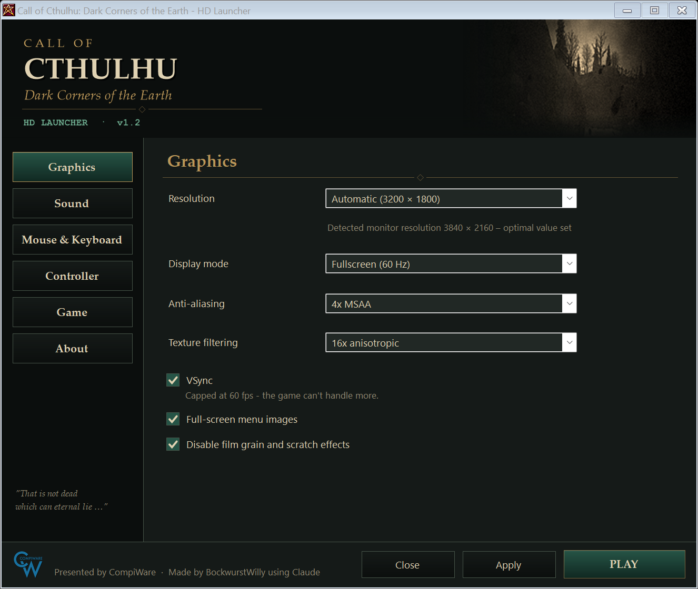
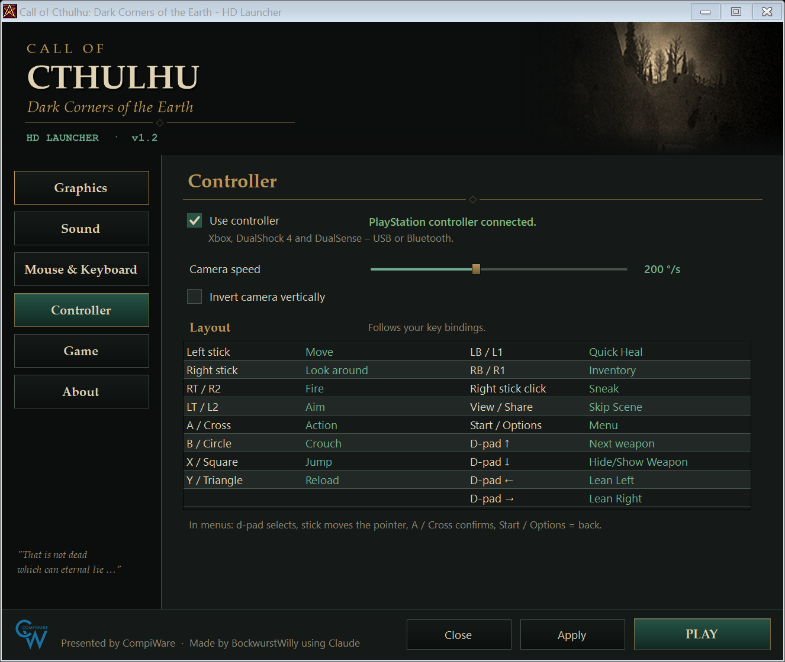

# Call of Cthulhu: Dark Corners of the Earth – HD Patch & Launcher

Unofficial HD patch with its own launcher for **Call of Cthulhu: Dark Corners of the Earth (GOG)** on Windows 10/11.
One setup, and the game runs at your monitor's resolution, survives Alt+Tab and plays with a modern mouse or an Xbox / PlayStation controller. Uninstalling restores the game folder byte for byte.

*Inoffizieller HD-Patch mit Launcher für die GOG-Version – deutsche Kurzfassung unten.*



## What it does

| Area | Solution |
|---|---|
| Resolution | taken from the monitor on every start (also from GOG Galaxy). Wider than 3276 px the inventory breaks (integer overflow in the HUD), so 4K renders at 3200 × 1800 and is scaled |
| Widescreen | ThirteenAG's Widescreen Fix: aspect ratio, HUD, text, videos |
| Fullscreen | borderless window over the whole monitor, monitor at 60 Hz while playing. The original crashes on Alt+Tab (it resets the device without releasing its resources) |
| Frame rate | locked to 60 fps – above that scripts hang and the known stairs / bookcase bugs appear |
| Graphics | MSAA (original feature), 16x anisotropic filtering, Large Address Aware; film grain and scratches can be switched off; the in-game brightness option and screen flashes work again (the game's gamma ramp, which Windows ignores for windowed games, is applied by the patch) |
| Mouse | frame-rate-independent mouse look, sensitivity on the Counter-Strike scale (0.022° × value per count). Measured: 1000 counts = 44.00° at 2.0, the same at 60 and 30 fps |
| Keyboard | key bindings and invert mouse in the launcher, presets "Original" and "Modern (WASD)", hold Del to clear a binding; stored in the game's own options |
| Controller | Xbox controllers and PlayStation controllers (DualShock 4, DualSense – read directly over USB or Bluetooth, no Steam or DS4Windows needed), translated into your key bindings. Default layout as in the Xbox version's manual; analog walking speed and any walking direction; d-pad navigates the menus |
| Sound | FMOD Ex mixes everything in software, without EAX or hardware 3D – the patch deliberately adds nothing |
| Game | skip the logo videos (story videos stay), subtitles, game language |
| Launcher | English or German (follows Windows, switchable under About) |



Full player documentation (German and English): [README.txt](README.txt) – also included in the download.

## Installation

1. Download `CoCHD_Patch_<version>.zip` from [Releases](../../releases), unzip it and run `CoCHD_Setup.exe`. It finds the GOG game by itself and checks the game files.
2. Play via "Call of Cthulhu - HD Launcher" or from GOG Galaxy as usual (the HD launcher replaces `CoCDCoTELauncher.exe`; the original is backed up).
3. Uninstall via Windows "Apps & Features" – every original file comes back.

Tested with the GOG release 1.0(A) (`CoCMainWin32.exe` SHA1 `84AD74871D8F1BCB3B647271E08963C7B24B48A6`).

### Controller layout (Xbox / PlayStation)

| Button | Action | Button | Action |
|---|---|---|---|
| Left stick | move (speed follows the tilt) | LB / L1 | quick heal |
| Right stick | look | RB / R1 | inventory |
| RT / R2 | fire | Right stick click | sneak |
| LT / L2 | aim | View / Share | skip scene |
| A / Cross | action | Start / Options | menu |
| B / Circle | crouch | D-pad ↑ | next weapon |
| X / Square | jump | D-pad ↓ | show / hide weapon |
| Y / Triangle | reload | D-pad ← / → | lean left / right |

In menus the d-pad selects, the stick moves the pointer, A confirms and Start goes back.

## Building

Requirements:

- Windows 10/11, Windows PowerShell 5.1
- Visual Studio 2022 Build Tools with "Desktop development with C++" (MSVC x86 for `CoCHD.asi`)
- .NET Framework 4.x (part of Windows; `csc.exe` for C# 7.3)

```powershell
powershell -ExecutionPolicy Bypass -File build.ps1
```

Output:

- `out\CoCHD_Setup.exe` – a single setup with everything embedded (launcher, payload, docs, licenses)
- `out\release\CoCHD_Patch_<version>.zip` – the package for a release

The version lives in `src\common\Text.cs` (`Version.Text`), both `AssemblyInfo.cs` and `src\asi\cochd.rc`.

## Testing

```powershell
# install -> update (settings kept) -> uninstall -> byte comparison with the starting state
powershell -ExecutionPolicy Bypass -File tests\e2e.ps1 -GameCopy "<copy: original Engine, Development\pcvideo, MainMenu\ENGAGINGSCREENS>"
# PlayStation report parser, offline
powershell -ExecutionPolicy Bypass -File tests\sony_parse_test.ps1
```

In-game tests (they take over mouse and keyboard – only when the PC is free):

- `tools\build-tools.ps1` – builds the test helpers into `tools\bin` (once)
- `tools\live\restart.ps1`, `toGame.ps1` – start the game, click into the game
- `tools\live\measure.ps1` – feed mouse counts, read the turned angle from the log
- `tools\live\alttab.ps1`, `gamma.ps1`, `grain.ps1` – Alt+Tab, gamma ramp, film grain
- `tools\fakepad\padsession.ps1 -Scenario speed|direction`, `menunav.ps1` – controller tests with a simulated pad (the test `xinput1_4.dll` is removed afterwards)

`CoCHD.asi` writes its measurements to `Engine\scripts\CoCHD.log` with `[Debug] Log=1`.
Launcher switches for tests: `/snapshot=<folder>`, `/keys=modern|original`, `/lang=en|de`. Setup: `/install /silent /dir="<game folder>"`, `/uninstall /silent`.

## Layout

```
src/asi/        CoCHD.asi – resolution, fullscreen, frame rate, mouse, controller, gamma, film grain (C, MSVC x86)
                sony_pad.h – DualShock 4 / DualSense input reports
src/common/     shared by launcher and setup: game detection, settings, key bindings, texts (DE/EN), theme
src/launcher/   CoCDCoTELauncher.exe – the HD launcher
src/setup/      CoCHD_Setup.exe – install, update, uninstall
src/res/        logos
payload/        third-party files for the game folder (unchanged) and their licenses
tests/          end-to-end test, PlayStation parser test
tools/          in-game tests, simulated pad
docs/           screenshots
```

Game files are **not** part of the repository (`reference/` and `out/` are in `.gitignore`).

## Technical notes

Everything happens in memory; apart from the Large Address Aware bit the exe stays unchanged. Every code location is found by byte pattern, not by a fixed address.

- **Fullscreen:** the game always gets a windowed device; "fullscreen" is a pinned borderless window plus a one-time switch to 60 Hz. Needless resets are skipped.
- **Gamma:** the game sets brightness and flashes with `SetGammaRamp`, which only exclusive fullscreen honours; the patch keeps the ramp and applies it before `Present` with a lookup texture and a small pixel shader.
- **Mouse:** the `dt × 60` factor in the look code (`fmul [60.0]`) becomes 1; the four look scales (1/65535) point to own values.
- **Controller:** XInput (or a DualShock 4 / DualSense read as HID) is read in the game's DirectInput polls and mapped onto the bindings in `Configuration.Data`. Walking: the movement code reads direction and speed from the keys and the configuration (MoveSpeedWalk/Run/Crawl); the patch replaces both while the pad walks. Measured: 30° stick → 29.7° walking direction.
- **Film grain:** a post-effect draws a 64×64 noise texture, refilled with `rand()` every frame, over the picture – stronger and with scratches in cutscenes. Its draw call is skipped when switched off.

## Credits

- **ThirteenAG** – [Ultimate ASI Loader](https://github.com/ThirteenAG/Ultimate-ASI-Loader) and [Widescreen Fixes Pack](https://github.com/ThirteenAG/WidescreenFixesPack) (MIT)
- **PCGamingWiki** community – notes on Alt+Tab, frame rate and known bugs
- The original Xbox manual (archive.org) – the controller layout

Details and versions: [THIRD-PARTY.txt](THIRD-PARTY.txt).

## License

© 2026 [BockwurstWilly](https://github.com/BockwurstWilly) – the patch's own code and docs are licensed under the
**[PolyForm Noncommercial License 1.0.0](LICENSE)**: you may use, share and change it for any non-commercial purpose,
as long as the `Required Notice` line (credit to BockwurstWilly with the link) stays with every copy.
Commercial use – selling, paid bundles, ad-financed download portals – only by arrangement: contact me via GitHub.

Third-party files in `payload/` keep their own licenses (see [THIRD-PARTY.txt](THIRD-PARTY.txt)). The logos in `src/res/` belong to their owners.

Call of Cthulhu: Dark Corners of the Earth © 2005 Bethesda Softworks LLC. Unofficial fan project; contains no game files.

---

## Deutsch

Inoffizieller HD-Patch mit eigenem Launcher für die GOG-Version von *Call of Cthulhu: Dark Corners of the Earth* unter Windows 10/11: Auflösung automatisch aus dem Monitor (höchstens 3276 Pixel breit, darüber zerbricht das Inventar), Widescreen Fix von ThirteenAG, Alt+Tab-sicheres Vollbild (randlos + 60 Hz), 60 fps, MSAA und 16x AF, Large Address Aware, Filmkorn abschaltbar, Helligkeit im Spielmenü und Blitz-Effekte wirken wieder, bildraten-unabhängige Maus mit Counter-Strike-Empfindlichkeit, Tastenbelegung im Launcher, Xbox- und PlayStation-Controller (DualShock 4 / DualSense direkt per USB oder Bluetooth) mit stufenlosem Laufen, Belegung wie in der Xbox-Fassung, Logo-Videos überspringen. Der Ton bleibt, wie das Spiel ihn macht (FMOD Ex). Launcher auf Deutsch oder Englisch. Ein Setup; die Deinstallation stellt den Spielordner byte-genau wieder her. Ausführlich: [README.txt](README.txt).

Lizenz: PolyForm Noncommercial 1.0.0 – frei nutzen, weitergeben und verändern, aber nicht kommerziell; der Hinweis auf BockwurstWilly muss bleiben. Kommerzielle Nutzung nur nach Absprache.

Made by BockwurstWilly using Claude
